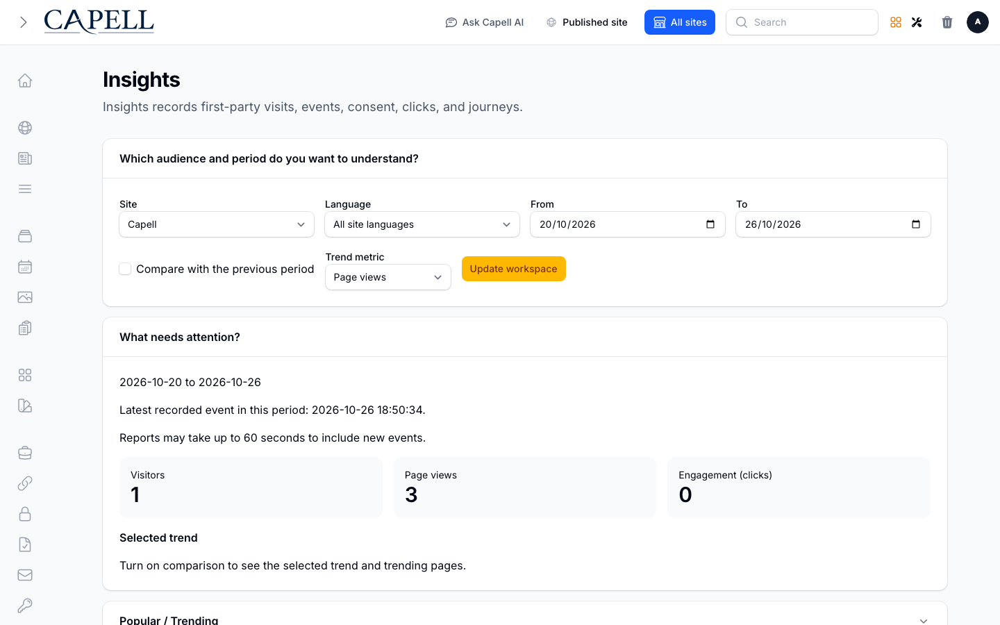
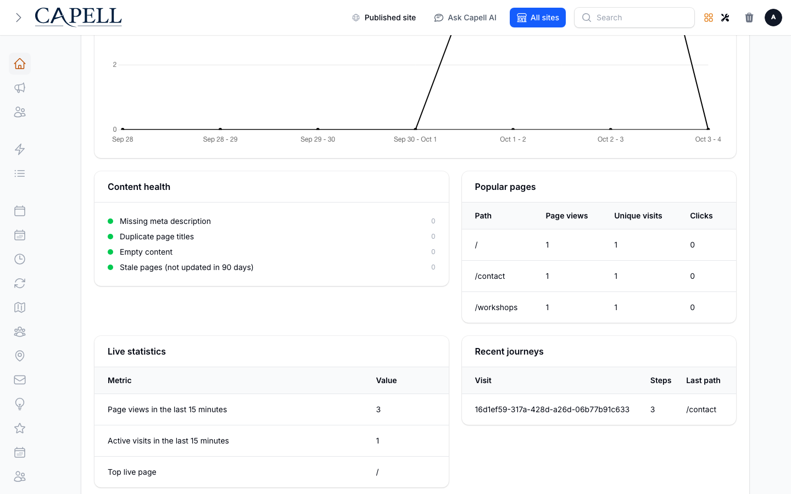

# Insights

<!-- prettier-ignore-start -->

## What It Does

Insights records first-party page views, events, journeys, conversions, and consent state for reporting inside Capell.

- **Price and availability:** Check current availability and price on the [Capell Marketplace listing](https://capell.app/extensions/insights).
- **Licence:** Check the licence terms on the [Capell Marketplace listing](https://capell.app/extensions/insights).
- **Requires:** `PHP ^8.4`, `capell-app/admin ^1.0.66`, `capell-app/core ^1.0.75`, `capell-app/frontend ^1.0.72`, `lorisleiva/laravel-actions ^2.8`, `spatie/laravel-data ^4.5`, `spatie/laravel-package-tools ^1.14.1`.
- **Install:** `composer require capell-app/insights`.

Admins can review overview metrics, trends, journeys, and dashboard widgets. Public pages send consent-aware events through the Insights beacon.

## Who It Is For

**For developers:** Typed Actions handle beacon validation, event storage, rollups, consent, and retention instead of spreading analytics logic across controllers and views.

**For teams:** Teams can inspect site activity and conversion paths without sending visitor analytics to a third-party reporting service.

## Quick Start

1. Install the package: `composer require capell-app/insights`.
2. Open the package admin surface at `/admin/insights` and confirm Insights is available.

## Configure

- **Configuration files:** `config/capell-insights.php`.
- **Admin settings:** `Capell\Insights\Settings\InsightsSettings`.
- **Commands:** `php artisan insights:purge`, `php artisan insights:rollups:rebuild`.

## Limits And Pitfalls

- Install the required Capell packages at the versions in `composer.json`: `capell-app/admin ^1.0.66`, `capell-app/core ^1.0.75`, `capell-app/frontend ^1.0.72`.
- Run migrations before opening package resources or public routes.
- Review middleware, throttling, signatures, and public-output safety in `routes/web.php` before exposing routes.
- Keep the host Laravel scheduler running so package-registered schedules can execute: `insights:purge (monthly; package registered)`, `insights:rollups:rebuild (daily; package registered)`.
- Keep public Blade and cached HTML free of authoring markers, model IDs, permissions, signed editor URLs, and lazy database queries.
- Custom write integrations must preserve invalidation for `insights` cache tags.

## Screens And Workflow

- Insights overview figures on the Insights page (admin).
- Popular pages widget (admin).
- Recent journeys widget (admin).
- Insights settings screen (admin).
- Frontend page with tracker active (frontend).
- Consent banner flow (frontend).
- Public root page with the Insights tracker active (frontend).
- Insights overview dashboard widgets with admin sidebar menu open (admin).

## Install Impact

- Required packages: `capell-app/admin`, `capell-app/core`, `capell-app/frontend`.
- Admin navigation: declares `admin-page: InsightsAdminPageContribution`; each Filament page or resource controls its own navigation visibility.
- Admin/editor extensions: `dashboard-widget: InsightsDashboardFilamentWidgetsContribution`, `overview-stat: InsightsOverviewStatsContribution`.
- Permissions: `View:InsightsPage`; Shield-generated page permissions for `Capell\Insights\Filament\Pages\InsightsPage` (names and grants depend on host Shield configuration).
- Public routes: loads `routes/web.php`; registers `InsightsRoutesContribution`.
- Database changes: package migrations are declared.
- Config: `config/capell-insights.php`.
- Settings: `Capell\Insights\Settings\InsightsSettings`.
- Queues or schedules: scheduled commands `insights:purge (monthly; package registered)`, `insights:rollups:rebuild (daily; package registered)`; queue jobs `ProcessInsightsBeaconJob`.
- Cache tags: `insights`.
- Commands: `insights:purge`, `insights:rollups:rebuild`.

## Troubleshooting

| Symptom | Likely cause | Check | Fix |
| --- | --- | --- | --- |
| Package surface is missing after install | Provider or manifest is not loaded | Confirm `capell.json`, package `composer.json`, and provider registration | Reinstall the package, refresh Composer autoload, and clear host caches |
| Admin screen or command fails on missing table | Package migrations have not run | Check the tables listed in `Data Model` | Run host migrations and rerun the focused package test |
| Route returns unexpected output | Route cache, middleware, or signed URL setup does not match the package route file | Check the route files listed in `Technical Shape` | Clear route cache and verify middleware before exposing public routes |
| Background work does not run | Queue worker or declared schedule is not active | Check the jobs and scheduled commands listed in `Technical Shape` | Start the queue worker or host scheduler, then run the focused command or package test |
| Public output leaks unexpected state | Render data, cache variation, or authoring boundary has regressed | Check public Blade, cache tags, and public-output safety tests | Move data loading out of Blade and rerun the package public-output tests |

## Upgrading

No manual steps between minor versions.

Read [CHANGELOG.md](CHANGELOG.md) before upgrading.

## Next Steps

- [Package docs](docs/README.md)
- [Overview](docs/overview.md)
- [Admin guide](docs/admin-guide.md)
- [Custom consent integration](docs/custom-consent.md)
- Configuration files: [`config/capell-insights.php`](config/capell-insights.php).
- [Troubleshooting](#troubleshooting)
- [Developer reference](docs/reference.md)
- [Marketplace assets](docs/assets/marketplace/)
- [Capell content language plan](../../docs/CONTENT_LANGUAGE_PLAN.md)
- [Capell documentation design system](../../docs/DESIGN_SYSTEM.md)
- [Capell and package ERD notes](../../docs/erd/capell-and-package-erds.md)
- Related packages: [Privacy Centre](../privacy-center/README.md).

<!-- prettier-ignore-end -->
